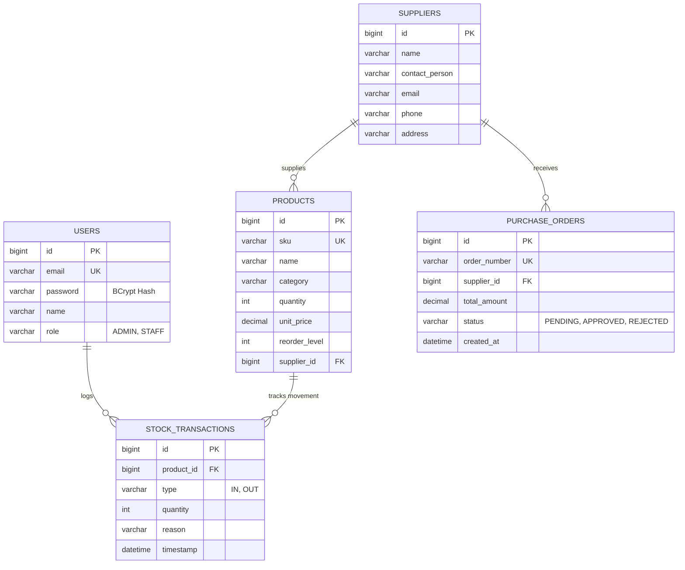

# 📦 AI-Powered Smart Inventory & Supply Chain Management System
### 🏆 VCUBE Hack Quest 1.0 — Problem Statement 3

[](https://adoptium.net/)
[](https://spring.io/projects/spring-boot)
[](https://spring.io/projects/spring-ai)
[](https://react.dev/)
[](https://tailwindcss.com/)
[](https://aiven.io/)

An enterprise-grade, autonomous inventory optimization platform that prevents warehouse stockouts, liquidates dormant capital, and drives automated procurement decisions using real-time database telemetry and Spring AI.

---

## 🌟 Executive Summary & Problem Solved

Every year, retail supply chains and warehouse operators suffer billions in losses caused by two critical extremes:
1. **Critical Stockouts**: High-velocity products suddenly running out of stock, causing lost customer contracts and revenue.
2. **Dead Capital Lockup**: Lakhs of rupees stranded in slow-moving, dormant inventory taking up expensive shelf space.
3. **Data Drift & Human Error**: Warehouse operations managed through disjointed, vulnerable spreadsheets prone to unauthorized deletions and stock miscounts.

### 💡 The Solution
Our platform bridges physical warehouse logistics with autonomous decision-making:
- **Real-Time Warehouse Telemetry**: Real-time stock counts with automated low-stock safety threshold triggers.
- **Atomic Stock Movements**: Indelible audit trail tracking every physical Stock-In (shipments) and Stock-Out (sales).
- **Enterprise RBAC**: Strict role boundaries protecting business assets (`ADMIN` exclusive permissions for approvals & deletions vs `STAFF` operational telemetry).
- **Grounded Spring AI Intelligence**: Multi-intent AI reasoning anchored directly in live cloud database records (not hallucinated chat).

---

## 🏗️ System Architecture

```
┌────────────────────────────────────────────────────────┐
│                   React 18 Frontend                    │
│   (Tailwind CSS + Lucide Icons + Recharts Telemetry)   │
└───────────────────────────┬────────────────────────────┘
                            │ REST / JSON (JWT Auth)
┌───────────────────────────▼────────────────────────────┐
│              Spring Boot 3.2 Backend Core              │
│ ┌────────────────────────────────────────────────────┐ │
│ │  Spring Security 6 (Stateless JWT + RBAC Filters)  │ │
│ ├────────────────────────────────────────────────────┤ │
│ │  Spring Data JPA + Hibernate (ACID Transactions)   │ │
│ ├────────────────────────────────────────────────────┤ │
│ │  Spring AI Engine (Context-Injected SQL Telemetry) │ │
│ └────────────────────────────────────────────────────┘ │
└───────────────────────────┬────────────────────────────┘
                            │
         ┌──────────────────┴──────────────────┐
         ▼                                     ▼
┌──────────────────┐                 ┌──────────────────┐
│ Aiven Cloud MySQL│                 │  OpenAI / Fallback│
│  (InnoDB 8.0)    │                 │   Engine Model   │
└──────────────────┘                 └──────────────────┘
```

---

## 🤖 The 4 Core AI Telemetry Engines

| AI Capability | Business Problem Solved | Real-Time Mechanism |
|---|---|---|
| **1. Natural Language Inventory Copilot** | Removes the need for complex SQL queries or manual spreadsheet searches. | Evaluates queries like *"what items are selling fast"*, queries past stock-out transactions, and ranks top velocity SKUs with restock advice. |
| **2. Dynamic Demand Forecasting** | Predicts stockout dates before they occur. | Computes product burn-rate curves against safety thresholds, visually plotting depletion dates and exact unit replenishment needs. |
| **3. Smart Purchase Recommender** | Maximizes replenishment efficiency under budget constraints. | Accepts a total procurement budget (e.g., \$25,000), evaluates all low-stock items against supplier unit pricing, and generates an optimal purchase plan. |
| **4. Warehouse Stock Optimization** | Detects dead capital and reduces holding costs. | Conducts automated health audits across warehouse categories, identifying dormant SKUs and calculating balance metrics. |

---

## 🗄️ Relational Database Schema (5 Core Tables)

Normalized relational schema hosted on **Aiven Cloud MySQL 8.0** with strict foreign key integrity and InnoDB row-level locking.



> **Design Principle**: Decoupling `purchase_orders` (financial procurement contracts) from `stock_transactions` (physical warehouse receipts) enables partial deliveries, multi-warehouse shipments, and complete financial auditability.

---

## 🔐 Enterprise Security & Role-Based Access Control (RBAC)

- **Authentication**: Stateless JSON Web Tokens (JWT) with BCrypt-hashed passwords.
- **Public Sign-ups**: Restricted exclusively to the `STAFF` role.
- **Admin Isolation**: Destructive actions (`DELETE /api/products/{id}`) and purchase order approvals (`PUT /api/purchase-orders/{id}/status`) are strictly guarded via `@PreAuthorize("hasRole('ADMIN')")`.

---

## 📡 REST API Reference & Postman Collection

The repository includes an exhaustive, pre-configured Postman Collection:
👉 **[vcube_inventory.postman_collection.json](file:///postman/vcube_inventory.postman_collection.json)** (20+ verified requests).

| Module | Method | Endpoint | Access Level | Description |
|---|---|---|---|---|
| **Auth** | `POST` | `/api/auth/register` | Public | Register new user (default `STAFF`) |
| **Auth** | `POST` | `/api/auth/login` | Public | Authenticate and obtain JWT token |
| **Products** | `GET` | `/api/products` | Authenticated | List all products with supplier metadata |
| **Products** | `POST` | `/api/products` | `ADMIN` only | Create new product SKU |
| **Products** | `GET` | `/api/products/low-stock` | Authenticated | Fetch items below safety reorder level |
| **Products** | `DELETE` | `/api/products/{id}` | `ADMIN` only | Remove SKU from catalog |
| **Suppliers** | `GET` | `/api/suppliers` | Authenticated | List registered vendor partners |
| **Suppliers** | `POST` | `/api/suppliers` | `ADMIN` only | Onboard new vendor |
| **Orders** | `GET` | `/api/purchase-orders` | Authenticated | Fetch all purchase orders |
| **Orders** | `POST` | `/api/purchase-orders` | Authenticated | Create procurement order |
| **Orders** | `PUT` | `/api/purchase-orders/{id}/status` | `ADMIN` only | Approve or reject purchase order |
| **Stock** | `POST` | `/api/stock-transactions` | Authenticated | Record physical Stock-In or Stock-Out |
| **AI** | `POST` | `/api/ai/query` | Authenticated | Natural Language Telemetry Copilot |
| **AI** | `POST` | `/api/ai/demand-forecast` | Authenticated | Depletion burn-rate analysis & curve |
| **AI** | `POST` | `/api/ai/purchase-recommendations`| Authenticated | Capital-optimized restock allocation |
| **AI** | `POST` | `/api/ai/stock-optimization` | Authenticated | Warehouse inventory balance audit |

---

## ⚡ Quickstart & Local Execution

### 1. Start the Spring Boot Backend
```powershell
# Windows
.\RUN-BACKEND.bat

# Linux / macOS
./RUN-BACKEND.sh
```
*Backend runs on `http://localhost:8080` and connects securely to Aiven Cloud MySQL.*

### 2. Start the React Frontend
```bash
cd frontend
npm install
npm run dev
```
*Frontend runs on `http://localhost:5173`.*

### 3. Demo Credentials
| Role | Email | Password |
|---|---|---|
| **Supervisor (ADMIN)** | `admin@vcube.com` | `Admin@123` |
| **Floor Associate (STAFF)** | `staff@vcube.com` | `Staff@123` |

---

## 📂 Project Structure

```
├── backend/
│   ├── src/main/java/com/vcube/inventory/
│   │   ├── config/          # Spring Security, JWT, CORS, OpenAPI
│   │   ├── controller/      # REST API Controllers (Auth, Product, AI, etc.)
│   │   ├── dto/             # Data Transfer Objects (Payload isolation)
│   │   ├── entity/          # JPA Entities (User, Product, Supplier, etc.)
│   │   ├── repository/      # Spring Data JPA Repositories
│   │   └── service/         # Business logic & Spring AI reasoning engine
│   └── pom.xml              # Maven dependencies & build configuration
├── frontend/
│   ├── src/
│   │   ├── api/             # Axios API client with JWT interceptor
│   │   ├── components/      # Reusable UI components & layouts
│   │   └── pages/           # Dashboard, Products, Suppliers, Orders, AIHub
│   └── package.json         # React 18, Vite, Tailwind CSS, Recharts
├── docs/
│   ├── PRESENTATION_DEMO_SCRIPT.md  # 5-minute presentation script & Q&A guide
│   └── DATABASE_ER_DIAGRAM.md       # Relational database schema reference
└── postman/
    └── vcube_inventory.postman_collection.json  # Exported API testing suite
```

---

## 👥 Hackathon Team (VCUBE Hack Quest 1.0)
- **Problem Statement**: Problem 3 — AI-Powered Smart Inventory & Supply Chain Management System
- **Engineered with**: Java 17, Spring Boot 3, React, Aiven MySQL, Spring AI
- **Deliverables**: Live UI, Live REST API, Normalized Schema, Postman Collection, Complete Demo Kit.
