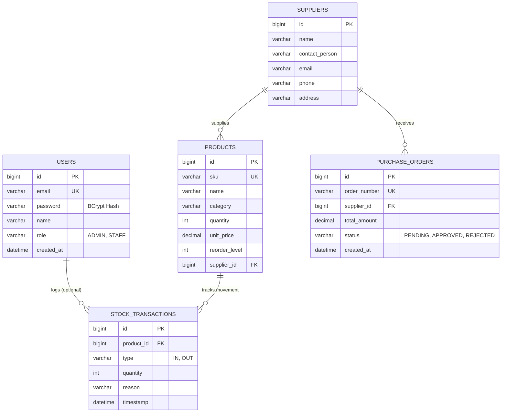

# 🗄️ Database Architecture & Entity-Relationship (ER) Diagram

**Platform**: Aiven MySQL 8.0 Cloud Database  
**Engine**: InnoDB (Row-Level Locking & ACID Compliance)  
**Schema Model**: Normalized 5-Table Relational Inventory Model  

---

## 📊 Entity Relationship Diagram

---

## 🔑 Key Schema Design Principles
1. **Financial Integrity & Stock Movement Separation**:
   - `purchase_orders` handles financial procurement contracts (`PENDING` -> `APPROVED`).
   - `stock_transactions` handles physical warehouse movements (`IN`, `OUT`).
   - Decoupling enables partial shipments, audit traceability, and prevents premature inventory inflation before physical receipt.
2. **ACID Transactional Isolation**:
   - Every stock transaction (`IN` or `OUT`) executes inside `@Transactional` with InnoDB row-level locking on `products.quantity`, preventing race conditions during concurrent warehouse operations.
3. **Enterprise Security & Identity**:
   - Passwords stored strictly as 60-character BCrypt hashes.
   - Role privileges strictly partitioned between `ADMIN` (mutations, approvals, deletions) and `STAFF` (read-only telemetry, inventory audits).
